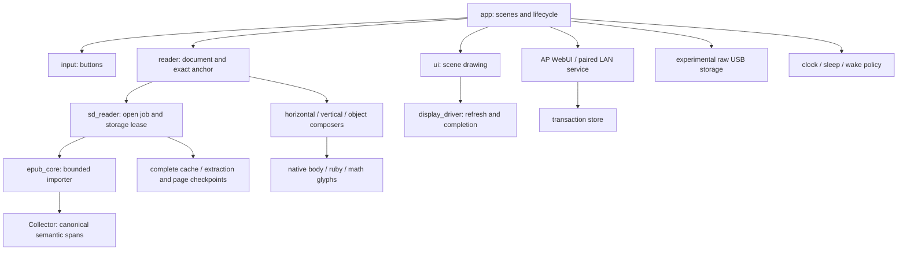

# Architecture and implementation

[English](architecture-and-implementation.md) · [简体中文](architecture-and-implementation.zh-CN.md)

This report describes module ownership, data formats, algorithms and failure behavior. Section 12 lists test coverage and known limits. Released behavior is recorded in the [release notes](releases/v0.3.0.md).

## 1. Execution model

PaperDIY Reader reads EPUB, UTF-8 TXT and Markdown from a FAT32 microSD card on the ESP32-S3 M5Stack PaperDIY. It uses a 540 × 960 monochrome framebuffer and preserves one source position per book.

`main.cpp` calls `appSetup()` and `appLoop()`. The application task owns navigation, the current document, local FAT operations, settings and network polling. Opening, pagination and cache publication use cooperative state machines. They share the application task; they are not background RTOS tasks. When experimental MSC is explicitly enabled, TinyUSB invokes its callbacks on a separate SDK task, with a separate storage ownership boundary and mutex.

Rendering reads state but does not persist progress. Navigation and lifecycle operations explicitly save it. A failed required save leaves the operation retryable instead of replacing the current book or powering off.

## 2. Resource and build envelope

| Resource | Configuration or bound |
| --- | --- |
| MCU / external memory | ESP32-S3; 16 MiB flash; 8 MiB OPI PSRAM |
| Application partition | Two 5 MiB slots; normal flashing writes application 0 at `0x10000` |
| NVS | `0x9000`, 20 KiB; separate from application bytes |
| Main loop stack | 16 KiB |
| Text address reservation | 4 MiB plus terminator, including when only cache windows are populated |
| Canonical page starts | At most 65,536 32-bit offsets: 256 KiB payload |
| Visible provisional window | At most 32 measured page starts |
| Incremental storage transfer | At most 8 KiB per step; filesystem calls remain synchronous |
| Experimental USB MSC callback | At most 4 KiB, 512-byte sectors |
| TLS buffers on the pinned SDK | 33,434 bytes of internal heap, plus contexts and crypto state |
| SD bus | SPI GPIO 39/40/38, CS 47; detect GPIO 48 active low |
| Navigation | GPIO 4 and 3, active low |

These limits do not guarantee that every maximum fits simultaneously. The importer checks available PSRAM and its largest free block before DOM allocation. Radio, TLS and DMA allocations can require internal RAM even when PSRAM is free.

[platformio.ini](../platformio.ini) pins the Espressif platform and M5 dependencies. The target uses GNU++11 and native USB (`ARDUINO_USB_MODE=0`) with CDC enabled at boot. MSC book transfer is disabled by default; only an explicit private experimental `PAPERDIY_EXPERIMENTAL_USB_MSC=1` build can expose it. Ordinary builds hide U and reject `USB_ENTER`. [partitions.csv](../partitions.csv) is the partition authority. OTA slots exist, but an OTA firmware endpoint is not implemented.

## 3. Source map and ownership

| Component | Responsibility and boundary |
| --- | --- |
| [app.cpp](../src/app.cpp) | Scenes, dispatch, opening, card events and orderly shutdown |
| [input.h](../src/input.h) | Click/hold/chord timing; no delayed navigation after loading |
| [reader.cpp](../src/reader.cpp) | Current source, exact anchor, page windows and canonical index |
| [sd_reader.cpp](../src/sd_reader.cpp), [sd_open_job.h](../src/sd_open_job.h) | Discovery, source admission, asynchronous open job and storage errors |
| [epub_core.h](../src/epub_core.h), [xml_input.h](../src/xml_input.h) | ZIP/resource access, normalized XML and canonical extraction |
| [epub_structure.h](../src/epub_structure.h) | Bounded semantic collection and chapter-boundary snapshots |
| [epub_document.h](../src/epub_document.h), [epub_reader.cpp](../src/epub_reader.cpp) | Canonical spans to render runs and objects; no EPUB-to-Markdown conversion |
| [markdown_document.h](../src/markdown_document.h), [markdown_reader.cpp](../src/markdown_reader.cpp) | Markdown IR, source/render mappings and styled rows |
| [reader_typography.h](../src/reader_typography.h), [line_quality.h](../src/line_quality.h) | Shared measuring/painting decisions and bounded line lookahead |
| [epub_vertical.h](../src/epub_vertical.h), [vertical_font.cpp](../src/vertical_font.cpp) | Vertical columns, native glyph orientation, ruby and digit combination |
| [math_layout.h](../src/math_layout.h) | Bounded expression boxes and glyph/rule commands |
| [sd_cache.h](../src/sd_cache.h), [deferred_cache.h](../src/deferred_cache.h) | Complete cache validation and checked incremental publication |
| [sd_extraction.h](../src/sd_extraction.h), [extraction_checkpoint.h](../src/extraction_checkpoint.h) | Canonical text spool and two extraction commit slots |
| [sd_checkpoint.h](../src/sd_checkpoint.h), [pagination_checkpoint.h](../src/pagination_checkpoint.h) | Independent partial page-index checkpoints |
| [content_manifest.h](../src/content_manifest.h), [sd_content.h](../src/sd_content.h) | Verified cached-text blocks and pinned source views |
| [storage_validation.h](../src/storage_validation.h), [resident_book.h](../src/resident_book.h) | Volatile trust scoped to one storage ownership epoch |
| [bookmark_store.h](../src/bookmark_store.h), [resume_store.h](../src/resume_store.h) | Checked book progress and boot-scene records |
| [ui.cpp](../src/ui.cpp), [display_driver.cpp](../src/display_driver.cpp) | Scene composition, dirty regions, rotation and panel completion |
| [network.cpp](../src/network.cpp), [web_page.h](../src/web_page.h) | Explicit AP/STA lifecycle and English WebUI |
| [lan_service.cpp](../src/lan_service.cpp), [lan_tls.cpp](../src/lan_tls.cpp), [lan_nvs.cpp](../src/lan_nvs.cpp) | Paired TLS service and fail-closed credential persistence |
| [live_policy.h](../src/live_policy.h) | P lifecycle: connection deadlines, external-power backoff, low-battery pause |
| [delivery_store.h](../src/delivery_store.h), [delivery_store_sd.cpp](../src/delivery_store_sd.cpp) | Non-overwriting files, bounded Push replacement and receipts |
| [usb_storage.cpp](../src/usb_storage.cpp), [usb_transport.cpp](../src/usb_transport.cpp) | Exclusive raw-card access and native CDC/MSC lifecycle |
| [power.cpp](../src/power.cpp), [card_sleep.h](../src/card_sleep.h) | CPU profiles, wake sources, card interrupt restoration and charging LED |

Header-only components expose storage, allocator, clock and glyph interfaces to native fault-injection tests. Global current-document state remains a coupling point. A future `DocumentSession`/`CacheStore` split should preserve these existing ownership boundaries rather than introduce concurrent FAT access.

## 4. User lifecycle

Boot validates the board and display, opens preferences, allocates the text buffer, scans the SD card and resolves the saved scene by book path. If the saved scene is reading, it restores the exact source position before replacing the retained shutdown overlay. Boot opening currently uses the synchronous wrapper; the normal loop-driven open path is cancellable at chapter boundaries.

The library has 22 rows per screen. A/B moves through books or pages; a short A+B chord opens or returns; holding both for two seconds requests shutdown. Library double-click recognition defaults to a 200 ms release-to-release window. Reading clicks do not wait for that window. Single-key repeat starts after 600 ms and repeats every 350 ms where enabled.

Rotation reverses library/reading navigation direction. Settings retain the physical N/A and R grouping; the default mode cycle is N → A → Off. New device settings belong in additional settings entries styled as books; detailed controls remain in the WebUI.

During `Loading`, ordinary navigation is consumed and discarded. The footer icon shows work without a central loading message. A power request is latched; the open job closes its handles and, when the optional journal is available, verifies a completed-chapter checkpoint before shutdown proceeds. Completion applies a separate 200 ms released-input guard, so clicks made during loading cannot become page turns afterward.

Shutdown saves the current anchor and scene before drawing. The prior framebuffer is thinned by a 4 × 4 ordered monochrome mask, then optional artwork is overlaid at bottom right. The default retains 50% of previous black pixels. After display completion, the app stops networking, cancels storage jobs, unmounts SD and powers off. E-paper retains the image without repeated painting.

## 5. Admission and EPUB extraction

[document_format.h](../src/document_format.h) is shared by discovery and uploads. Discovery skips dot names, traverses to a bounded depth, sorts paths and admits at most 256 books.

| Input | Bound / behavior |
| --- | --- |
| TXT | 4 MiB; strict UTF-8, optional BOM removed |
| Markdown | 1 MiB original UTF-8 source |
| EPUB archive | 64 MiB source; extracted text limited to 4 MiB |
| Directory ending `.epub` | Bounded resource callbacks; same importer |

The importer validates ZIP central-directory and local-header bounds, rejects ZIP64/multidisk forms, decompresses stored/deflated resources and checks exact output size and CRC. It then reads container XML, package manifest and spine. Auxiliary `linear="no"` resources follow the primary spine until link navigation is implemented. Encrypted text is rejected; no remote resource is fetched.

| Import resource | Limit |
| --- | --- |
| ZIP entries / spine items | 2,048 each |
| Aggregate ZIP names / spine paths | 128 KiB each |
| Resource path | 1,024 bytes |
| Container or encryption XML | 64 KiB |
| Package XML | 256 KiB |
| Compressed chapter / decoded chapter | 1 MiB each |
| XML depth / estimated DOM allocation | 32 / 2 MiB |
| Canonical text | 4 MiB |

XML normalization validates encoding, entities, depth and estimated allocation before TinyXML2 receives input. Deflate state uses the checked heap allocator instead of the task stack. Completion must consume the declared compressed bytes, produce the declared output and pass CRC.

Canonical extraction normalizes ordinary whitespace, preserves preformatted content, emits paragraph separators and skips scripts, style text, images and SVG. Semantic spans annotate these same bytes. An unsupported semantic feature cannot silently change bookmark coordinates. Optional metadata allocation failure permits flat text fallback; a transient fallback cannot overwrite a richer cache or become a resident-document hit.

### Chapter-resumable opening

`Importer::begin()` validates the package and builds its chapter plan. `stepChapter()` processes one chapter; `run()` remains a compatibility wrapper for native tools, WASM and boot. It retains a full chapter buffer/DOM, not a suspended parser between input chunks.

The normal application uses `beginOpenSD()`, `pollOpenSD()` and `cancelOpenSD()`. Results are `Pending`, `Ready`, `Failed` or `Cancelled`. Cache hits may finish immediately. A cold job advances one chapter or one checkpoint I/O step per poll. Cancellation is requested during cooperative input probes and becomes terminal only after owned handles close. Source validation and individual filesystem/parser operations still impose latency.

Extraction durability is independent of pagination:

- One `.exttext` spool holds at most 4 MiB of canonical text. Only the suffix beyond the last committed prefix is written.
- Two `.ext0`/`.ext1` slots contain a 192-byte header and at most 1 MiB of metadata each. They bind source identity, extractor/text/semantic revisions, chapter plan, cursor, dependency graph, Collector state and prefix digest.
- New bytes and metadata are read back before a commit becomes usable. A torn newer slot leaves an older valid slot available. On restore, source/dependencies and the saved prefix are revalidated.
- Rejection of both slots reconstructs fresh package/Collector state before continuing; rejected bytes cannot contaminate a fresh import.
- On the normal journal path, complete extraction is verified before pagination starts. Partial extraction never supplies a normal book key, bookmark or complete page cache.

Collector snapshots include record/resource/language tables and bounded math data. They contain no live XML stack. Restart resumes at a completed chapter, not inside deflate or DOM parsing. Allocation, metadata-budget or unavailable-write failures can disable the optional journal while a valid in-memory import continues. Short reads/writes, failed readback and source or lease changes fail closed. The open job independently checks the same nonzero storage lease before every poll and before publication, including when the journal is disabled. The extraction products occupy at most 6 MiB + 384 bytes per book. Bounded step transfers do not bound synchronous package/source/dependency validation.

## 6. Layout and document semantics

All layout coordinates refer to UTF-8 byte offsets. Source text is never modified to insert discretionary hyphens or spacing. The same composer measures pages and paints glyphs.

### Horizontal text

The line breaker keeps ordinary English words together, uses bounded US/GB pattern hyphenation, respects nonbreaking spaces and word joiners, and protects supported combining sequences. Native fractional advances and font-derived Latin kerning accumulate in 1/64 px units. Limited lookahead compares candidate line endings; this is not whole-paragraph TeX optimization. Long unbreakable tokens have an explicit emergency-break path.

CJK rules prohibit selected punctuation/small-kana line starts and invalid line ends, protect paired em dashes/ellipses, and allow up to 4 px optical hanging. Contextual punctuation compression uses glyph ink bounds with a 14 px cap and 2 px separation. Han/ASCII spacing adds 0, 2 or 4 px without altering explicit spaces. Justification excludes final paragraph lines, code, emergency breaks and incompatible mixtures. Heading/paragraph page-edge keeps are bounded.

| Reading preset | Native font | Line advance | Left / right edge |
| --- | --- | --- | --- |
| Compact | 24 px | 34 px | 18 / 516 |
| Standard | 28 px | 40 px | 24 / 510 |
| Relaxed | 28 px | 46 px | 36 / 498 |

Glyphs are drawn at native sizes, without bitmap scaling. Pagination yields under a shared 50 ms work budget; painting uses an 8 ms budget. These cooperative checks do not preempt one expensive operation.

### Japanese vertical text

A supported explicit `vertical-rl` declaration selects vertical columns. Japanese language, Han characters or RTL page progression alone do not. The bounded CSS subset accepts simple selectors, inheritance and inline precedence: at most 128 rules and eight local sheets, 64 KiB each and 128 KiB total. It omits general selectors, `@import`, media queries and the full CSS cascade.

Columns run top to bottom and right to left. Unicode orientation data plus baked Japanese regional/vertical substitutions select native 24/28 px glyphs. Sideways Latin glyphs retain their full ink. Ruby uses native 12/14 px glyphs, supports at most eight base and sixteen annotation characters, and stays atomic with its source span. Explicit one/two-digit combination uses tate-chu-yoko. Mode transitions start a new page; 180° device rotation is separate.

This is a bounded subset of Japanese layout. Complex ruby, unsupported glyphs and oversized atoms fall back to complete canonical text. Regional coverage outside the fixed JIS repertoire, full JLREQ, complex shaping and vertical mathematics are not guaranteed. Exact font audit and CSS limits are in [EPUB typesetting](epub-typesetting.md).

### Markdown, mathematics and tables

MD4C builds rendered text, bounded semantic runs and monotonic source/render maps from the original Markdown. Generated markers and decoded entities can differ from source bytes, so saved positions stay in original-source coordinates. Limits are 1 MiB rendered text, 4,096 runs, 8,192 mappings and a 512 KiB parser budget. Parse failure discards partial IR and exposes original text. Code preserves spaces/newlines, uses native 24 px proportional glyphs and disables prose justification/hyphenation.

The math renderer accepts a bounded TeX-like subset and emits glyph/rule commands. It does not execute macros or include external files. Limits are 4,096 source bytes, 256 nodes, depth 16, 1,024 commands, 8 × 8 matrix cells and 128 KiB workspace. Eight retained command slots add approximately 128 KiB on the target. STIX Two Math glyphs use native 14/20/28 px sizes.

EPUB presentation MathML can translate into display-only TeX while retaining canonical flattened text. An admitted formula consumes its complete source span once; adjacent display formulas occupy separate rows. Unsupported notation, geometry or allocation falls back to the complete canonical span, which may not reproduce the original mathematical notation.

Simple EPUB tables use two to four equal-width columns, wrapped text, headers and grid lines. Rows remain atomic across pages and use the remaining page body when they fit. Nested/spanning/nonrectangular tables, tables containing MathML and oversized rows fall back to prose. There is no automatic column sizing or repeated-header algorithm. See [Markdown and math](markdown.md) and [EPUB typesetting](epub-typesetting.md) for the accepted syntax.

## 7. First page, pagination and progress

Opening distinguishes three costs: source validation/extraction, the first readable page, and complete canonical pagination. Progressive pagination reduces the second cost; it does not bypass validation of a cold EPUB.

After complete admitted text is available, `progressive_index::safeStart()` selects a UTF-8 boundary at or before the exact saved anchor and looks back at most 256 bytes through an ordinary Latin word. It measures a page there immediately. A local window holds at most 32 pages and extends on navigation. Backward reconstruction measures at most 16 pages from a seed 4,096 bytes earlier, adjusted by the same bounded word/UTF-8 lookbehind; a small overlap is possible, but the preceding byte is not skipped.

Separately, `pollSDBackground()` builds canonical pages from byte zero, requesting at most two pages under a 12 ms soft budget per loop visit. One page is indivisible and can exceed the budget. Work runs in Reading/Library when keys are idle; Settings pauses it. Unknown page totals show `…`, with a footer work icon. Completion updates the footer without moving the visible page. The next explicit page turn adopts the canonical page containing the next unread or preceding byte.

Three identities remain separate:

| Identity | Purpose |
| --- | --- |
| Path digest | Locate source-specific storage products |
| Canonical content key | Define what a saved source offset means |
| Layout identity | Bind pages to geometry, settings, language and semantics |

Current bookmark keys use `c` plus a 56-bit SHA-256 prefix over a versioned domain, framed path and canonical text. This fits NVS key limits; it is not a security authenticator. `currentReadingOffset()` retains the exact anchor even when its containing page begins earlier. Opening, redraw, reflow and shutdown do not snap it backward. Navigation changes it.

Changed positions and the last-book path are checked separately; unchanged values avoid writes. If canonical extraction changes, migration matches bounded surrounding text with a whitespace-insensitive KMP scan and prefers repeated passages near the prior relative position. The new anchor must persist before old recovery data can be replaced. Invalid progress or unreadable required recovery data produces an error rather than silently restarting at zero.

## 8. Cache and trust model

A cache is disposable; the source and reading progress are not. The application owns local FAT exclusively; cache publication and incremental/window jobs require a matching live storage lease. Fresh source validation can perform full verification without a reusable proof. Mount, mutation, sleep entry, USB handoff and storage failures invalidate volatile trust.

| Product | Contents / validation |
| --- | --- |
| `.bin` complete cache | 112-byte header, metadata, complete page starts and text; digest/readback before publication |
| `.tmp` / `.bak` | Owned temporary and prior valid generation; checked rotation |
| `.exttext`, `.ext0`, `.ext1` | Extraction prefix and two independently verified chapter commits |
| `.idx0` / `.idx1` | Partial canonical indexes; two slots, at most 524,624 bytes total |
| Content manifest | Bound cache prefix and SHA-256 per 8 KiB text block; at most 16,504 bytes |
| Resident session | Current verified RAM book; path/key/lease/layout/length and exact-anchor checks |

The complete-cache envelope is version 3. Metadata is bounded to 512 KiB and 4,096 dependencies. Each dependency records a relative resource name, size, mtime and full SHA-256; missing optional resources have an explicit sentinel. Page offsets must increase strictly from zero. Older formats/layouts may supply migration evidence but cannot silently provide current pages. Text revision and EPUB semantic revision are validated separately.

Cold validation hashes source bytes and checks stamps before and after. Size/mtime alone do not establish unchanged content. Two 64-entry volatile rings remember source fingerprints and validated dependency graphs only within the same ownership epoch. Repeated opens can reuse these proofs; reboot cannot.

`DeferredCacheWrite` starts only after canonical indexing and a checked progress save. It snapshots metadata/pages, borrows the unchanged text buffer and writes/verifies at most 8 KiB per step. Every step checks lease, pointer, length, key and layout. Open, flush and rename remain synchronous. Readback compensates for Arduino `flush()` lacking an error result. Rename is an application publication barrier, not proof of FAT power-loss durability.

Page-index checkpoints bind source/dependencies, text/semantics and layout. They begin at 32 pages, then require at least 128 additional pages and five seconds. Restoration occurs after the first readable page and cannot move its anchor. A partial index is never serialized as a complete cache.

Authenticated text windows retain the 4 MiB address reservation while loading only verified blocks. A pinned view includes lookbehind, the following canonical page and 1,024 bytes of lookahead where available, clipped at end of text. Semantic objects require their entire referenced spans. Pathological spans request full verified materialization. Failed materialization restores the prior pinned view and anchor transactionally. This reduces cache I/O, not reserved RAM or cold-source hashing.

## 9. Phone and host preparation

The browser Worker/WASM and host CLI use the same C++ importer and semantic encoder as the device. Preparation moves ZIP/XML work to the sender while preserving original EPUB bytes as the authority. It supplies text and semantics, not device page indexes.

| Format | Purpose |
| --- | --- |
| `PDS1` | Contiguous semantic runs; 16-byte header |
| `PDS2` | Writing/combine flags and ruby; 24-byte header |
| `PDS3` | Math/table/row/cell descriptors and TeX pool; 40-byte header |
| `PDT1`, wire 1, extractor 2 | Prepared-content envelope; 160-byte header |

The shared PDS maximum is 352,808 serialized bytes, with at most 16,384 runs, 2,048 ruby groups, 256 formulas, 32 tables, 256 rows and 1,024 cells. In-memory geometry costs are additional. `PDT1` binds source size/digest, extractor identity, language, payload lengths and text/metadata digest. It contains no progress, Wi-Fi data or local device path. `book.epub.pdt` is an optional sidecar and never a library book.

The WebUI uploads the original first, uses the server-confirmed filename for its sidecar and runs preparation in a terminable Worker. AP receipts establish delivery. Before use, the reader verifies the complete source fingerprint, sidecar digest, UTF-8 and semantic bounds. Invalid or old preparation falls back to device import. A sidecar-header digest detects newly supplied preparation without repeatedly ingesting an unchanged sidecar.

Native/WASM tests compare complete PDT bytes and decoded semantic meaning. A loopback browser test establishes CSP/Worker/upload integration; it does not measure a physical phone or ESP32 AP throughput. Commands and schema details are in [prepared content](prepared-content.md).

## 10. Settings, display and power

`readerCfgV1` is a validated 20-byte record with version, bounds, reserved bytes and CRC-32. Save succeeds before behavior changes. Geometry-related fields affect page identity; input timing, refresh cadence and artwork do not.

| Preference | Default / range |
| --- | --- |
| CJK punctuation compression | On |
| Han/ASCII spacing | 4 px; choices 0/2/4 px |
| Library double click | 200 ms; 100–400 ms |
| Reading geometry | Standard; three native-size presets |
| English hyphenation / alignment | On / justified; left alignment available |
| Refresh policy | Balanced; Clarity / Less flashing alternatives |
| Shutdown retained ink | 50%; 0–100% |
| Artwork | Firmware fallback, two upload slots or none |

`resumeV2` stores scene, stable settings ID and a bounded path. Corrupt V2 does not revive stale V1. Rotation has checked persistence. `wifiCfgV1` stores Wi-Fi separately; endpoints do not return its password. Application NVS is not encrypted.

Partial refresh is the normal page path. Scene changes and periodic cleanup retain necessary full refreshes. Status areas (P icon, battery, loading icon, reader footer, delivery progress lines) always refresh fast and neither count toward nor trigger the periodic full refresh; geometry/settings changes invalidate the relevant refresh baseline. Panel completion is awaited before shutdown.

The CPU uses 240 MHz for active work and 80 MHz in ordinary idle. USB storage ownership holds the active profile until raw-driver release. External power, live radio, USB and unstable input/storage block manual light sleep. Button/card wake sources are rearmed after wake; the LED follows charging status. These are software policies. No measured standby current or battery-life claim is available. See [power](power.md) for the tested wake boundary.

## 11. Networking and USB

### AP WebUI

Normal network state is explicit: Off, AP or STA/LAN. USB storage remains an experimental state behind the compile gate. The AP supplies English settings, provisioning, uploads and optional preparation. Requests have bounded headers/bodies, authentication and upload state. New files are published without overwriting ordinary books. Incomplete transfers stay owned temporaries and are checked before publication.

Shutdown artwork conversion occurs in the browser: decode a local image, fit the display, generate bounded monochrome `PDI1` and preview it. The device validates dimensions/header/CRC, writes the inactive artwork slot, verifies it and then persists selection. Removal persists “none”; it does not modify a compiled private fallback.

### LAN delivery

The STA service opens only when selected. It uses a device P-256 certificate, TLS 1.2 ECDHE-ECDSA/AES-128-GCM and exact certificate-DER SHA-256 pinning before sender credentials or HTTP bytes. Bearer authorization is separate. AP cookies and provisioning routes do not apply to LAN clients.

The receiver lives only on Settings with N active. Every delivery is an offered batch of 1–8 entries that the user accepts with one short A+B; uploads outside the accepted batch are refused, and the accepted set ends with the N session. An unknown sender's first batch pairs it through a commit/reveal short authentication string shown on the reader, so pairing needs no QR, camera or clipboard. The bounded packed-entry parser ([lan_batch.h](../src/lan_batch.h)) runs before authentication and is fuzzed. While N is active the reader answers mDNS for `paperdiy-<deviceId>.local` and `_paperdiy._tcp`; the device ID is the certificate fingerprint prefix. Paired senders are listed, removed or forgotten from the AP WebUI.

The separate `paperlan` namespace stores identity and at most four client verifiers. Only an explicit missing record permits creation; read/type/commit errors fail closed. Uncertain credential writes invalidate the RAM registry until a verified reload. Client labels are bounded UTF-8 and exclude control characters.

The store permits one transaction, chunks up to 4 KiB, verification up to 8 KiB per poll and sixteen client-scoped receipts. Ordinary delivery creates a new book. Push is at most 16 KiB Markdown in two owned slots; revisions overwrite rather than accumulate. Only two fixed digest-bound progress records exist, and Push bypasses ordinary per-revision caches. The sender retains history. Ambiguous publication is reported as Uncertain and recovered by checking bytes. Protocol and skill integration are in [LAN protocol](lan-protocol.md).

### USB storage

USB book transfer is paused because actual-SD failures remain unresolved. Default builds retain CDC but disable MSC, hide U and reject `USB_ENTER`. The implementation below is retained only for explicitly enabled experimental builds; RAM-disk acceptance does not establish raw SD reliability.

The host owns the entire raw card in HostOwned, ExitRequested and Fault. The application saves progress, closes local handles, invalidates leases and unmounts FAT before exposing sectors. Synchronization, removal prevention and valid host eject govern release. Disconnect, suspend, bus reset or idle time alone cannot return FAT ownership to the reader.

Ownership blocks local book/cache/art access, ordinary shutdown and remote bootloader reset. A separate RAM-disk build tests MSC without touching the card. Read/write callbacks are bounded in bytes, but SD/SDK calls can still block in time. First-failure diagnostics retain the initiating error instead of replacing it with later NotReady responses.

Safe eject and raw-driver release are required before software reset or flashing. The native CDC recovery path uses 1200 baud only after this guard. Application-only updates preserve NVS when the partition table is unchanged; they do not authorize whole-flash erasure.

Final raw-card acceptance remains open. The earlier successful transfer and subsequent failures are separate evidence; the current attempt is recorded in section 12.

A checked build-time replacement corrects the pinned SDK card-lifetime issue: the card was freed before the SPI lock destructor used it. It compiles an SD source copy without modifying the installed framework. Read/write callbacks release their mutex and yield one RTOS tick, including the busy/retry path. Source and linked-ELF inspection showed that own-task USB queue sends already use zero wait; no SDK queue patch is applied. An 88-byte, two-slot CRC journal in RTC memory records stage/counters/stack watermark across supported resets without NVS writes. These measures do not establish the cause of the disconnect; a single SDK SPI call can still block.

## 12. Tests and limits

Native CMake tests use ASan/UBSan, assertions and injectable storage, allocator and clock interfaces. Python generates synthetic fixtures and checks font assets; Node runs the browser code. Coverage includes malformed input, allocation failures, chapter and page recovery, canonical-text/PDS parity, layout geometry, protocol replay and storage ownership. Diagnostic commands and device fixtures require explicit build flags.

USB mass storage is disabled by default because actual-SD disconnects remain unresolved. RAM-disk tests do not establish real-card reliability. Other limits include full EPUB/CSS compatibility, universal font coverage, complex Japanese shaping, FAT power-loss durability and unmeasured standby current.

## 13. Build, publication and next boundaries

Build with Python 3.12+, the pinned development requirements and PlatformIO. Native tests also require CMake, a C++ compiler, OpenSSL headers and Node 18+. Committed browser assets run without Emscripten; regeneration uses pinned Emscripten 4.0.18. See [development](development.md) for commands.

CI checks public-source admission, firmware build, sanitizer tests, generated assets and source reproducibility. A local gate must run before upload because CI cannot prevent an already-uploaded leak. Public source includes generic optional-art support and open font subsets. Personal artwork, books, progress, credentials, flash/NVS dumps, local logs and private handoff notes stay outside it. A successful CI run does not itself publish a release.

Application code is MIT. MD4C, TinyXML2, Noto/STIX derivatives, Unicode data, the browser runtime and ESP32 components retain their respective licenses and modification notices in [third-party notices](../THIRD_PARTY_NOTICES.md). Code copied from another reader requires a license decision; a citation alone does not grant compatibility.

The next architectural boundaries to preserve are:

1. **Document session:** own text, semantics, exact anchor and active jobs together, with explicit teardown.
2. **Storage owner:** one authority for local FAT versus raw USB, leases and failure recovery.
3. **Importer state:** resume only authenticated completed work; never publish partial text as a complete identity.
4. **Layout contract:** shared measurement/painting and explicit resident-span bounds across horizontal, vertical and object paths.
5. **Transport store:** separate AP provisioning, LAN authorization and durable delivery semantics.

Performance costs and research sources are in [performance research](performance-research.md). Historical design notes remain dated references rather than claims about the current implementation.
