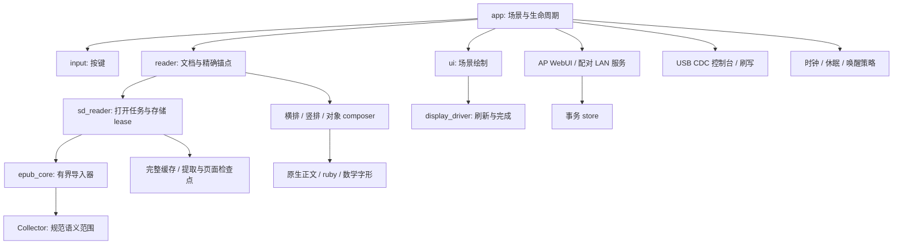

# 架构与实现

[English](architecture-and-implementation.md) · [简体中文](architecture-and-implementation.zh-CN.md)

本文说明模块所有权、数据格式、算法及故障处理。第 12 节列出测试覆盖与已知限制。已发布行为见[发布说明](releases/v0.3.0.zh-CN.md)。

## 1. 执行模型

PaperDIY Reader 在 ESP32-S3 M5Stack PaperDIY 上读取 FAT32 microSD 中的 EPUB、UTF-8 TXT 和 Markdown，使用 540 × 960 单色 framebuffer，为每本书保留一个源位置。

`main.cpp` 调用 `appSetup()`、`appLoop()`。应用任务管理导航、当前文档、本地 FAT、设置和网络轮询。打开、分页、缓存发布使用协作式状态机，共用应用任务，并非后台 RTOS 任务。

渲染读取状态，但不保存进度；导航和生命周期操作显式保存。必要保存失败时，操作保持可重试，而不是替换当前书或关机。

## 2. 资源与构建范围

| 资源 | 配置或上限 |
| --- | --- |
| MCU / 外部内存 | ESP32-S3；16 MiB flash；8 MiB OPI PSRAM |
| 应用分区 | 两个 5 MiB 槽；正常刷写在 `0x10000` 写 application 0 |
| NVS | `0x9000`，20 KiB；独立于应用字节 |
| 主循环栈 | 16 KiB |
| 文本地址预留 | 4 MiB 加终止字节，包括只填充缓存窗口时 |
| 规范页起点 | 最多 65,536 个 32 位偏移，payload 256 KiB |
| 可见临时窗口 | 最多 32 个测量页起点 |
| 增量存储传输 | 每步最多 8 KiB；文件系统调用仍同步 |
| 锁定 SDK 的 TLS 缓冲 | 内部堆 33,434 字节，另加上下文/密码状态 |
| SD 总线 | SPI GPIO 39/40/38，CS 47；卡检测 GPIO 48 低有效 |
| 导航 | GPIO 4、3，低有效 |

这些上限不保证全部最大值同时可用。导入器在 DOM 分配前检查可用 PSRAM 和最大空闲块。即使 PSRAM 有空闲，无线、TLS、DMA 也可能需要内部 RAM。

[platformio.ini](../platformio.ini)锁定 Espressif 平台和 M5 依赖。目标使用 GNU++11、原生 USB（`ARDUINO_USB_MODE=0`），启动启用 CDC。USB 只承载串口控制台和刷写，卡从不作为 USB 大容量存储暴露。[partitions.csv](../partitions.csv)是分区权威。存在 OTA 槽，但未实现 OTA 固件端点。

## 3. 模块索引与所有权

| 组件 | 职责与边界 |
| --- | --- |
| [app.cpp](../src/app.cpp) | 场景、分派、打开、卡事件、有序关机 |
| [input.h](../src/input.h) | 点击/长按/组合键时序；加载后不延迟导航 |
| [reader.cpp](../src/reader.cpp) | 当前源、精确锚点、页窗口、规范索引 |
| [sd_reader.cpp](../src/sd_reader.cpp)、[sd_open_job.h](../src/sd_open_job.h) | 发现、源准入、异步打开、存储错误 |
| [epub_core.h](../src/epub_core.h)、[xml_input.h](../src/xml_input.h) | ZIP/资源访问、XML 归一化、规范提取 |
| [epub_structure.h](../src/epub_structure.h) | 有界语义收集与章节快照 |
| [epub_document.h](../src/epub_document.h)、[epub_reader.cpp](../src/epub_reader.cpp) | 规范范围转渲染 run/对象，不转成 Markdown |
| [markdown_document.h](../src/markdown_document.h)、[markdown_reader.cpp](../src/markdown_reader.cpp) | Markdown IR、源/渲染映射、样式行 |
| [reader_typography.h](../src/reader_typography.h)、[line_quality.h](../src/line_quality.h) | 共用测量/绘制决策和有界断行前看 |
| [epub_vertical.h](../src/epub_vertical.h)、[vertical_font.cpp](../src/vertical_font.cpp) | 竖排列、原生字形朝向、ruby、数字组合 |
| [math_layout.h](../src/math_layout.h) | 有界表达式盒及字形/线条命令 |
| [sd_cache.h](../src/sd_cache.h)、[deferred_cache.h](../src/deferred_cache.h) | 完整缓存验证和已校验增量发布 |
| [sd_extraction.h](../src/sd_extraction.h)、[extraction_checkpoint.h](../src/extraction_checkpoint.h) | 规范文本 spool 和双提取提交槽 |
| [sd_checkpoint.h](../src/sd_checkpoint.h)、[pagination_checkpoint.h](../src/pagination_checkpoint.h) | 独立部分页索引检查点 |
| [content_manifest.h](../src/content_manifest.h)、[sd_content.h](../src/sd_content.h) | 验证缓存文本块和固定源视图 |
| [storage_validation.h](../src/storage_validation.h)、[resident_book.h](../src/resident_book.h) | 一个存储 epoch 内的易失信任 |
| [bookmark_store.h](../src/bookmark_store.h)、[resume_store.h](../src/resume_store.h) | 已校验书籍进度和启动场景 |
| [ui.cpp](../src/ui.cpp)、[display_driver.cpp](../src/display_driver.cpp) | 场景、脏区域、旋转、面板完成 |
| [network.cpp](../src/network.cpp)、[web_page.h](../src/web_page.h) | 显式 AP/STA 生命周期、英文 WebUI |
| [lan_service.cpp](../src/lan_service.cpp)、[lan_tls.cpp](../src/lan_tls.cpp)、[lan_nvs.cpp](../src/lan_nvs.cpp) | 配对 TLS 服务及遇错关闭的凭据持久化 |
| [live_policy.h](../src/live_policy.h) | P 生命周期：连接时限、外接电源退避、低电量暂停 |
| [delivery_store.h](../src/delivery_store.h)、[delivery_store_sd.cpp](../src/delivery_store_sd.cpp) | 不覆盖文件、有界 Push 替换、回执 |
| [usb_transport.cpp](../src/usb_transport.cpp) | 供睡眠策略使用的 USB 主机连接状态 |
| [power.cpp](../src/power.cpp)、[card_sleep.h](../src/card_sleep.h) | CPU 档位、唤醒源、卡中断恢复、充电 LED |

仅头文件组件向主机故障注入测试暴露存储、分配、时钟和字形接口。全局当前文档仍有耦合。未来拆为 `DocumentSession`/`CacheStore` 时应保留现有所有权边界，不能引入并发 FAT 访问。

## 4. 用户生命周期

启动验证板/显示、打开偏好、分配文本缓冲、扫描 SD，并按书籍路径解析保存场景。若恢复阅读，先恢复精确源位置，再替换保留的关机叠图。启动打开当前用同步封装；正常循环驱动路径可在章节边界取消。

书库每屏 22 行。A/B 移动书或页；短 A+B 打开/返回；同时按住两秒请求关机。书库双击默认是 release-to-release 200 ms；阅读点击不等该窗口。启用单键重复时，600 ms 后开始、每 350 ms 重复。

旋转反转书库/阅读导航方向；设置保留物理 N/A 与 R 分组，默认模式循环为 N → A → 关闭。新设备设置应加入书籍样式设置项，详细控制留 WebUI。

`Loading` 消费并丢弃普通导航。页脚图标表示工作，不显示中央 loading 文案。电源请求被锁存；打开任务关闭句柄并在日志可用时完成有效检查点后才继续关机。完成另有 200 ms 输入释放门禁，加载期间点击不能变成随后翻页。

关机先保存锚点/场景，再绘图。原 framebuffer 经 4 × 4 有序单色掩码稀疏，再于右下叠加可选图片；默认保留 50% 原黑像素。显示完成后停网络、取消存储任务、卸载 SD、关机。电子纸无需重复绘制即可保留图像。

## 5. 准入与 EPUB 提取

[document_format.h](../src/document_format.h)由发现和上传共用。发现跳过点名称、限制递归深度、排序路径，最多准入 256 书。

| 输入 | 上限 / 行为 |
| --- | --- |
| TXT | 4 MiB；严格 UTF-8，移除可选 BOM |
| Markdown | 1 MiB 原始 UTF-8 源 |
| EPUB 归档 | 源 64 MiB；提取文本最多 4 MiB |
| `.epub` 结尾目录 | 有界资源回调，同一导入器 |

导入器检查 ZIP central/local header 边界，拒绝 ZIP64/多盘，支持 stored/deflated，检查精确输出长和 CRC；随后读 container XML、package manifest、spine。链接导航实现前，辅助 `linear="no"` 资源跟在主 spine 后。拒绝加密文本，不取远程资源。

| 导入资源 | 上限 |
| --- | --- |
| ZIP 条目 / spine 项 | 各 2,048 |
| ZIP 名称合计 / spine 路径合计 | 各 128 KiB |
| 资源路径 | 1,024 字节 |
| container / encryption XML | 64 KiB |
| package XML | 256 KiB |
| 压缩章 / 解码章 | 各 1 MiB |
| XML 深度 / 估计 DOM 分配 | 32 / 2 MiB |
| 规范文本 | 4 MiB |

XML 在交给 TinyXML2 前先验证编码、实体、深度、估计分配。deflate 状态使用已检查堆，不占任务栈。完成时必须消费声明压缩字节、产生声明输出并通过 CRC。

规范提取归一化普通空白，保留预格式文本，输出段落分隔，跳过 script、style 正文、图片和 SVG。语义注释同一字节。未支持语义不能暗改书签坐标。可选元数据分配失败允许完整纯文本回退，但临时回退不能覆盖更丰富缓存或成为驻留文档命中。

### 可按章恢复的打开

`Importer::begin()` 验证包并建立章节计划，`stepChapter()` 处理一章，`run()` 是原生工具、WASM、启动兼容封装。仍保留完整单章缓冲/DOM，不在输入块之间挂起解析器。

正常应用使用 `beginOpenSD()`、`pollOpenSD()`、`cancelOpenSD()`，返回 `Pending`、`Ready`、`Failed`、`Cancelled`。缓存命中可立即完成；冷任务每 poll 推进一章或一次检查点 I/O。协作输入探针请求取消，拥有句柄关闭后才成为终态。源验证及单次文件系统/解析器操作仍带来延迟。

提取耐久性独立于分页：

- `.exttext` 最多 4 MiB 规范文本，只写最后提交前缀之后的后缀。
- `.ext0`/`.ext1` 各有 192 字节头、最多 1 MiB 元数据，绑定源身份、提取/文本/语义版本、章节计划、游标、依赖图、Collector、前缀摘要。
- 新字节和元数据回读后提交才可用；新槽撕裂保留有效旧槽。恢复重新验证源/依赖及前缀。
- 两槽拒绝后先重建包/Collector 初态再继续，拒绝字节不能污染新导入。
- 正常日志路径在启动分页前提交完整提取；部分提取不提供普通书籍键、书签或完整页缓存。

Collector 快照包含记录/资源/语言表及有界数学数据，不含活动 XML 栈。重启从完成章节继续，不在 deflate/DOM 内恢复。分配、元数据预算或写入不可用可禁用可选日志，完整内存导入仍可继续；短读/写、回读失败、源或 lease 改变则关闭操作。每次 poll 和发布前独立检查同一个非零 storage lease，即使日志已禁用。每书提取产物最多 6 MiB + 384 字节。有界单步传输不约束同步的包/源/依赖验证耗时。

## 6. 排版与文档语义

全部坐标使用 UTF-8 字节偏移。不会为软断词/间距修改源文本；测量与绘制使用同一 composer。

### 横排文本

断行器保持普通英文词，用有界 US/GB 规则断词，尊重不换行空格/word joiner，保护支持的组合序列。原生小数 advance 和字体拉丁 kerning 以 1/64 px 累计。有限前看比较候选行尾，不是全段 TeX 优化。超长不可断 token 有明确紧急断行。

CJK 规则禁止选定标点/小假名行首及非法行尾，保护配对破折号/省略号，允许最多 4 px 光学悬挂。上下文标点压缩使用 ink，最多 14 px、留 2 px 间隔。汉字/ASCII 添加 0/2/4 px，不改变显式空格。末段行、代码、紧急断行、不兼容混合不两端对齐；标题/段落页边保留有界。

| 阅读档位 | 原生字体 | 行进 | 左 / 右边界 |
| --- | --- | --- | --- |
| 紧凑 | 24 px | 34 px | 18 / 516 |
| 标准 | 28 px | 40 px | 24 / 510 |
| 宽松 | 28 px | 46 px | 36 / 498 |

字形原生绘制，不缩放位图。分页用共用 50 ms 工作预算让出，绘制用 8 ms；协作检查不能抢占单次昂贵操作。

### 日文竖排

显式支持的 `vertical-rl` 声明才选择竖排列；日语、汉字、RTL 页序不单独触发。有界 CSS 子集支持简单选择器、继承和 inline 优先；最多 128 规则、八个本地样式表，各 64 KiB、合计 128 KiB。不含一般选择器、`@import`、media query 或完整 cascade。

列内由上到下，列由右到左。Unicode 朝向加烘焙日文地区/竖排替代选择原生 24/28 px。侧向拉丁保留完整 ink。ruby 使用原生 12/14 px，最多八个基字、十六个注音字符，与源跨度保持原子。显式一/两位数字以 tate-chu-yoko 组合。模式切换新开页；设备 180° 旋转独立。

这是有界日文子集。复杂 ruby、未支持字形、超大原子回退完整规范文本。固定 JIS 范围外地区字形、完整 JLREQ、复杂 shaping、竖排数学不保证。精确字体审计和 CSS 限制见 [EPUB 排版](epub-typesetting.zh-CN.md)。

### Markdown、数学和表格

MD4C 从原 Markdown 建渲染文本、有界 run、单调源/渲染映射；生成标记/解码实体可不同于源字节，因此进度仍在原源坐标。限制为渲染文本 1 MiB、4,096 run、8,192 映射、512 KiB 解析预算。失败丢弃部分 IR，显示原文本。代码保留空格/换行，用原生 24 px 比例字体，不做正文对齐/断词。

数学渲染接受有界 TeX 风格子集，输出字形/线条命令，不执行 macro 或外部 include。最多 4,096 源字节、256 节点、深度 16、1,024 命令、8 × 8 矩阵、128 KiB 工作区。八个保留命令槽在目标上另约 128 KiB。STIX Two Math 为原生 14/20/28 px。

EPUB presentation MathML 可转为只用于显示的 TeX，规范展平文本不变。准入公式一次消费完整源范围；相邻 display 公式分行。不支持语法、几何或分配回退完整规范跨度，但可能不能复现原数学记法。

简单 EPUB 表格支持两至四等宽列、折行文本、表头和网格。行跨页保持原子，能放下时利用当前页剩余正文空间。嵌套/跨行跨列/非矩形表、含 MathML 表、超大行回退正文。不自动列宽、不自动重复表头。准入语法见 [Markdown 与数学](markdown.zh-CN.md)、[EPUB 排版](epub-typesetting.zh-CN.md)。

## 7. 首屏、分页与进度

打开区分源验证/提取、首个可读页面、完整规范分页。渐进分页减少第二项，不绕过冷 EPUB 验证。

获得完整准入文本后，`progressive_index::safeStart()` 在精确锚点或之前选 UTF-8 边界，最多回看 256 字节穿过普通拉丁词，立即测页。本地窗口最多 32 页，导航时扩展。向后重建最多测量 16 页，从前移 4,096 字节的种子开始，并应用同样有界的词/UTF-8 回看调整；可略重叠，不跳过前一字节。

独立 `pollSDBackground()` 从字节零建规范页，每循环最多两页、12 ms 软预算。单页不可分、可超预算。Reading/Library 按键空闲时运行，Settings 暂停。未知总数 `…`，页脚工作图标；完成更新页脚不移动当前页，下次主动翻页采用含下一未读/前一字节的规范页。

三种身份分开：

| 身份 | 用途 |
| --- | --- |
| 路径摘要 | 定位源特定存储产物 |
| 规范内容键 | 定义保存源偏移含义 |
| 排版身份 | 将页面绑定几何、设置、语言、语义 |

当前书签键为 `c` 加 56 位 SHA-256 前缀，输入是版本域、带长度路径及规范文本；满足 NVS 键长，不是安全认证。`currentReadingOffset()` 保留精确锚点，即使所在页更早开始。打开、重绘、重排、关机不向后对齐；导航才改变它。

位置和 last-book 路径分别校验；值未变避免写。规范提取改变时，以忽略空白的 KMP 扫描匹配有界上下文，重复段优先靠近原相对位置。新锚点成功持久化后才替换旧恢复数据。进度无效/必要恢复数据不可读则报错，不默默归零。

## 8. 缓存与信任模型

缓存可丢弃，源和进度不可。应用独占本地 FAT；缓存发布、增量任务和窗口任务要求匹配的有效 storage lease。重新验证源时，可以在没有可复用证明的情况下执行完整验证。挂载、修改、进入休眠、USB 交接、存储失败撤销易失信任。

| 产物 | 内容 / 验证 |
| --- | --- |
| `.bin` 完整缓存 | 112 字节头、元数据、完整页表、文本；发布前摘要/回读 |
| `.tmp` / `.bak` | 自有临时和有效旧代，已校验轮换 |
| `.exttext`、`.ext0`、`.ext1` | 提取前缀和两个独立章节提交 |
| `.idx0` / `.idx1` | 部分页索引，双槽合计最多 524,624 字节 |
| 内容清单 | 绑定缓存前缀与每 8 KiB 文本块 SHA-256，最多 16,504 字节 |
| 驻留会话 | 当前验证 RAM 书；检查路径/键/lease/排版/长度/精确锚点 |

完整缓存封装版本 3；元数据最多 512 KiB、4,096 依赖。每依赖记录相对资源名、大小、mtime、完整 SHA-256，可选缺失资源有显式 sentinel。页偏移从零严格递增。旧格式/排版可作迁移证据，不能暗中提供当前页面。文本版本与 EPUB 语义版本分别验证。

冷验证哈希源，并在前后核对 stamp；大小/mtime 不证明未变。两个各 64 项易失环只在同一所有权 epoch 保存源指纹及依赖图；重复打开可复用，重启不行。

`DeferredCacheWrite` 仅在规范索引和进度校验保存后启动，快照元数据/页表，借用未变文本，每步最多写/验证 8 KiB。每步检查 lease、指针、长度、键、排版。打开/flush/rename 仍同步。回读弥补 Arduino `flush()` 无错误返回。rename 是应用发布屏障，不证明 FAT 断电耐久。

页索引检查点绑定源/依赖、文本/语义、排版；从 32 页开始，此后至少新增 128 页和五秒。恢复在首屏后进行，不移动锚点。部分索引不序列化为完整缓存。

认证文本窗口只加载已验证块，仍预留 4 MiB 地址。固定视图含回看、下一规范页、至少 1,024 字节前看（限于 EOF）。语义对象要求完整引用范围，异常跨度请求完整验证加载；失败事务性恢复旧窗口和锚点。这减少缓存 I/O，不减少预留 RAM 或冷源哈希。

## 9. 手机与主机预处理

浏览器 Worker/WASM、主机 CLI 与设备共用 C++ 导入器/语义编码器。预处理将 ZIP/XML 移到发送端，原 EPUB 字节仍是权威；仅提供文本/语义，不提供设备页索引。

| 格式 | 用途 |
| --- | --- |
| `PDS1` | 连续语义 run，16 字节头 |
| `PDS2` | writing/combine 标志、ruby，24 字节头 |
| `PDS3` | 数学/table/row/cell 描述及 TeX 池，40 字节头 |
| `PDT1`，wire 1，extractor 2 | 预处理封装，160 字节头 |

共享 PDS 序列化上限 352,808 字节，最多 16,384 run、2,048 ruby、256 公式、32 表、256 行、1,024 cell；内存几何开销另计。`PDT1` 绑定源大小/摘要、提取器、语言、payload 长和文本/元数据摘要，不含进度、Wi-Fi、本地路径。`book.epub.pdt` 是可选旁车，不是书库书。

WebUI 先上传原书，再按服务端确认名称上传旁车，准备运行在可 terminate Worker。AP 回执证明传输。使用前 reader 验证完整源指纹、旁车摘要、UTF-8、语义边界。旧/无效旁车回退设备导入；旁车头摘要能识别新准备，而不重复读入未变旁车。

原生/WASM 测试比较完整 PDT 和语义。loopback 浏览器证明 CSP/Worker/上传集成，不测实体手机或 ESP32 AP 吞吐。命令/格式见[预处理内容](prepared-content.zh-CN.md)。

## 10. 设置、显示与电源

`readerCfgV1` 是经版本、边界、保留位、CRC-32 验证的 20 字节记录，成功保存后才改行为。几何字段影响页面身份；输入时序、刷新频率、图片不影响。

| 偏好 | 默认 / 范围 |
| --- | --- |
| CJK 标点压缩 | 开 |
| 汉字/ASCII 间距 | 4 px；可选 0/2/4 px |
| 书库双击 | 200 ms；100–400 ms |
| 阅读几何 | 标准；三个原生尺寸档 |
| 英文断词 / 对齐 | 开 / 两端；可左对齐 |
| 刷新策略 | 均衡；清晰 / 少闪可选 |
| 关机保留 ink | 50%；0–100% |
| 图片 | 固件回退、两个上传槽或无 |

`resumeV2` 保存场景、稳定设置 ID、有界路径；V2 损坏不复活旧 V1。旋转有校验持久化。`wifiCfgV1` 独立保存 Wi-Fi，端点不返回密码；应用 NVS 未加密。

翻页正常使用局刷；场景变化/周期清理保留必要全刷。状态区域（P 图标、电量、加载图标、阅读页脚、投递进度行）始终快速局刷，不计入也不触发周期全刷；几何/设置变化失效相应刷新基线。关机前等待面板完成。

CPU 活动工作 240 MHz、普通空闲 80 MHz。外电、无线、USB、输入/存储不稳定时阻止手动 light sleep。唤醒后重设按键/卡源，LED 跟随充电状态。这是软件策略，尚无待机电流/续航实测；唤醒边界见[电源](power.zh-CN.md)。

## 11. 网络与 USB

### AP WebUI

普通网络状态显式为 Off、AP、N 的 STA/LAN，或 P 的持久 STA/LAN。AP 提供英文设置、配网、上传、可选预处理；请求具有有界头/体、认证及上传状态。新文件不覆盖普通书，未完成传输留在自有临时文件，发布前校验。

关机图片在浏览器解码、适配显示、生成有界单色 `PDI1` 并预览。设备验证尺寸/头/CRC，写非活动槽、回读，再保存选择。移除先保存 none，不修改编译私人回退。

### LAN 传输

STA 仅显式选择时开服务。设备 P-256 证书、TLS 1.2 ECDHE-ECDSA/AES-128-GCM，发送凭据/HTTP 前精确 pin 证书 DER 的 SHA-256。Bearer 独立；AP cookie/配网路由不适用于 LAN。

N 的接收端只在设置页且 N 激活时存在。每次投递是 1–8 项的批次，用户短按一次 A+B 接受；不在已接受批次中的上传被拒绝，已接受集合随 N 会话结束。未知发送端的第一批通过阅读器上显示的承诺/揭示短验证码完成配对，因此配对不需要二维码、摄像头或剪贴板。有界的打包条目解析器（[lan_batch.h](../src/lan_batch.h)）在认证前运行并经过模糊测试。N 期间阅读器应答 `paperdiy-<deviceId>.local` 与 `_paperdiy._tcp` 的 mDNS 查询；设备 ID 是证书指纹前缀。已配对发送端在热点网页中列出、移除或全部遗忘。P 在设置页之外也保持同一个接收端运行，但只接受此前在 N 里配对过的发送端发来的 Push，批次和配对一律拒绝（见 [LAN 协议](lan-protocol.zh-CN.md#p实时-push)）。

独立 `paperlan` 保存身份及最多四个客户端 verifier；只有明确缺失才允许创建，读取/类型/提交错误关闭准入。不确定写使 RAM registry 失效，直到验证重载。标签有界 UTF-8，不含控制字符。

store 同时一个事务、块最多 4 KiB、验证每 poll 最多 8 KiB、十六个客户端隔离回执。普通传输新建书；Push 最多 16 KiB Markdown，用两个自有槽覆盖版本而不累计。只有两个固定摘要进度记录，绕过普通逐版本缓存；历史由发送端保留。模糊发布报告 Uncertain，以字节核验恢复。协议/skill 见 [LAN 协议](lan-protocol.zh-CN.md)。

### USB

USB 只用作串口控制台和刷写通道，阅读器从不把卡暴露给电脑。书籍通过 A、N/P 或安全取出的卡传入。早先的实验性大容量存储模式已经删除，因为实际 SD 断连问题一直没有解决。

运行时控制台是原生 TinyUSB CDC（`ARDUINO_USB_MODE=0`）。以 1200 波特率打开它会重启进 ROM 下载器，下载器枚举为另一个 USB-Serial/JTAG 设备，所以刷写不需要 BOOT 键。分区表不变时，仅更新应用会保留 NVS，不授权擦除整片 flash。已配置或挂起的 USB 主机会阻止浅睡眠。

经检查的构建替换修正锁定 SDK 的 card 生命周期问题：原代码先释放 card，再由 SPI 锁析构访问它。构建编译修正后的 SD 源副本，不改已安装 framework，并作用于每次卸载，包括拔卡。另一个经检查的替换串行化 TinyUSB 设备控制器的 FIFO-empty 掩码更新，CDC 控制台依赖它；见[开发](development.zh-CN.md)。

## 12. 测试与限制

原生 CMake 测试使用 ASan/UBSan、断言以及可注入的存储、分配器和时钟接口。Python 生成合成夹具并检查字库资源；Node 运行浏览器代码。覆盖损坏输入、分配失败、章节与分页恢复、规范文本/PDS 一致性、排版几何、协议重放和存储所有权。诊断命令与设备夹具需要显式构建标志。

没有 USB 大容量存储。其他限制包括完整 EPUB/CSS 兼容性、通用字库覆盖、复杂日文 shaping、FAT 断电耐久性，以及尚未测量的待机电流。

## 13. 构建、发布与后续边界

Python 3.12+、锁定开发依赖、PlatformIO 构建。原生另需 CMake、C++、OpenSSL 头、Node 18+。提交的浏览器资源无需 Emscripten 即可运行；再生锁定 Emscripten 4.0.18。命令见[开发指南](development.zh-CN.md)。

CI 检查公开源准入、固件、sanitizer、生成资源、源再现。上传前必须本地门禁，因为 CI 不能阻止已上传泄漏。公开源码可含通用可选图片和开放字体子集；私人图片、书、进度、凭据、flash/NVS dump、本地日志、私人交接必须在外。CI 成功不自动发布。

应用 MIT；MD4C、TinyXML2、Noto/STIX 派生、Unicode、浏览器 runtime、ESP32 组件按各自许可证/修改声明，见[第三方声明](../THIRD_PARTY_NOTICES.md)。引用其他 reader 不授予复制许可，复制需许可证决策。

后续架构应保留：

1. **文档会话：**共同拥有文本、语义、精确锚点、活动任务，明确 teardown。
2. **存储所有者：**统一本地 FAT、lease、故障恢复权威。
3. **导入状态：**只恢复认证完成工作，部分文本不发布完整身份。
4. **排版约定：**水平/竖排/对象共享测绘并显式限制驻留跨度。
5. **传输 store：**分离 AP 配网、LAN 授权、耐久传输语义。

性能成本/研究来源见[性能研究](performance-research.zh-CN.md)。历史设计记录是有日期参考，不是当前实现宣言。
